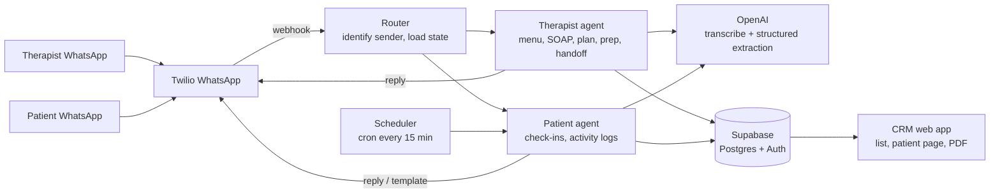

Contents

1. [Press release](#press)
2. [Problem](#problem)
3. [Goals & metrics](#goals)
4. [Happy flows](#flows)
5. [Architecture](#architecture)
6. [Data model](#data)
7. [Requirements](#requirements)
8. [Constraints](#constraints)
9. [Build plan](#plan)
10. [Responsibilities](#owners)
11. [LTV hypotheses](#ltv)
12. [Open questions](#open)
13. [FAQ](#faq)

PRD · LTV final project · v0.1 draft

# Bitácora: a WhatsApp agent for physical therapy clinics

Therapists record each session with a voice note. Patients log homework and pain between visits. Everything lands in one simple clinical record the clinic can search, hand over and print.

**Team** Cherub · Iñigo · Marina **Status** Draft for Monday build session **Updated** 17 Nov 2026 **Working name** Bitácora (“logbook”), easy to change

## Press release

Written as if we had already launched, to force clarity on who it is for and why it matters. Everything after this section is the actual spec.

MEXICO CITY · PILOT LAUNCH

### Physical therapists in Mexico can now update a clinical record in under two minutes, straight from WhatsApp

Bitácora turns a post-session voice note into a structured SOAP note, keeps patients on their home program between visits, and gives every therapist the full story on a patient before they walk in.

Small physical therapy clinics in Mexico must keep a clinical record for every patient. Today that means a paper form filled in by hand after each session, about five minutes per patient. A therapist seeing ten patients a day loses close to an hour to paperwork, and the forms go into a drawer and are rarely read again. Between sessions, patients forget their exercises, and when they come back they cannot remember how their knee felt on Tuesday's run.

With Bitácora, the therapist sends a 60-second voice note to the clinic's WhatsApp number after each session. The agent turns it into a SOAP note in clinical language, asks for anything required that is missing, and saves it after the therapist confirms. The therapist also sets the home plan: which exercises, how often, and which activities to test. The agent then reminds the patient each day, asks which exercises they did, and records pain when they return to running, climbing stairs or lifting. Before the next session, or when a patient switches therapists, any therapist can ask for a brief and get the full picture in one message.

“I talk for a minute on my way to the next patient and the note is done. When I take over someone else's patient, I read one message instead of chasing my colleague down the hall.”Illustrative quote for the press release. Not a real customer.

Bitácora runs on WhatsApp because that is where Mexican therapists and patients already are. There is nothing to install. The clinic gets a simple web record with every note, the patient's own logs, and a one-click PDF export to print, sign and file in the paper record.

## Problem and context

\~5 min

to write up each session by hand

\~50 min/day

lost per therapist at \~10 patients a day

\~20 min

for a new therapist to get up to speed on a transferred patient

2–3×/week

sessions per patient, each one a new paper entry

Figures are team estimates from clinic conversations. Validate with the clinic before they go in the report.

#### Therapist

- **Documentation is slow.** Records are required for compliance (NOM-004-SSA3-2012), so every session ends with a handwritten form.
- **The data is dead.** Notes sit on paper, are not searchable, and are not used to prepare the next session.
- **Handoffs are verbal.** When a therapist is overbooked and a patient moves, the new therapist has to ask the old one.
- **Referring orthopedists get no updates.** Progress after surgery is not shared back in any structured way.

#### Patient

- **Lots of homework.** Strength, mobility and flexibility exercises after each session.
- **Low adherence.** Patients forget or are too busy, and nobody checks in until the next visit.
- **Return-to-activity tests.** “Run 30 minutes and see how the knee feels.”
- **Poor recall.** At the next visit they have to remember whether it hurt, where, how much, when it started and how long it lasted.

### Why not an AI scribe?

Ambient scribes record the whole visit. That fits a 15-minute diagnostic consult, but not a one-hour PT session that is mostly massage, routine exercise and casual chat. Established patients often do their routine with no verbal description at all. Recording everything also raises privacy concerns for patients. A short structured voice note after the session captures what matters with less risk and less noise.

## Goals, non-goals and success metrics

#### Goals

- Cut documentation time per session from \~5 min to under 2 min.
- Put patient data to use: session prep, therapist handoff and (later) orthopedist updates.
- Help patients follow the home plan and capture how they feel between sessions.
- Be so simple that a therapist can use it on day one with no training.

#### Non-goals for this project

- Scheduling, billing, marketing or reception agents (the expansion story, not this build).
- Replacing the signed paper record. Paper stays the legal record; we print into it.
- Ambient recording of sessions.
- Any clinical advice from the agent to patients.
- Certified electronic health record (NOM-024) compliance.

### How we will know it works

| Metric | Baseline | Target for demo | How we measure |
| --- | --- | --- | --- |
| Time to document one session | \~5 min | \< 2 min, voice note to saved note | Timestamps on the message log |
| Required SOAP fields captured on first pass | n/a | ≥ 90% across 10 test notes | Count follow-up questions per note |
| Notes the therapist has to correct | n/a | \< 1 in 5 | “Edit” taps on the confirmation step |
| Patient check-in response rate | No check-ins today | ≥ 60% of reminders answered over a pilot week | Reminders sent vs. check-ins logged |
| Time to get up to speed on a transferred patient | \~20 min | \< 5 min reading one brief | Ask the real therapist |
| Real users | 0 | 1 therapist + 1 patient end to end | Pilot with the clinic contact |

## Happy flows

All user-facing copy ships in Mexican Spanish (es-MX). Examples are in English so the whole team can review them. Buttons are WhatsApp quick replies or list pickers.

FLOW A

### Therapist registers a new patient

1. Therapist sends anything (“hola”, “menu”). The router sees the number belongs to a therapist and shows the menu.
2. Therapist taps *New patient*. The agent asks for fields one at a time, or accepts them all in one message or voice note and extracts them.
3. Agent shows a summary card. Therapist confirms.
4. Patient row is created in the CRM, assigned to this therapist.
5. The patient receives a welcome template asking for consent (privacy notice) and opt-in for reminders, plus a preferred reminder time.

Therapist ↔ Bitácora

hola

Hi Dr. Ana. What would you like to do?

New patientSession notePrep a sessionPatient handoff

New patient

Send me the patient's name, WhatsApp number, date of birth, diagnosis and referring doctor. A voice note works too.

▶ 0:22 voice note

**Laura Méndez** · +52 55 1234 5678 · DOB 14/03/1991\
Dx: post-op ACL reconstruction, right knee\
Referred by: Dr. Ruiz (orthopedics)\
First visit: today

SaveEdit

Save

Saved. I've sent Laura a welcome message to confirm consent and reminders.

FLOW B · CORE

### Therapist records a session note and sets the home plan

1. Therapist taps *Session note* and picks the patient from a list (their patients, most recent first) or says the name.
2. Therapist sends one voice note covering how the patient is, what was measured and done, their assessment, and the plan.
3. Agent transcribes it and extracts a SOAP note in clinical language plus a structured home plan.
4. If a required field is missing (e.g. pain score), the agent asks one short question.
5. Agent shows the note and the plan. Therapist taps *Confirm* or *Edit*.
6. On confirm: note is saved and locked, the plan becomes the active plan, and the patient's reminders are rescheduled.

Therapist ↔ Bitácora

Session note → Laura Méndez

Go ahead. Tell me how she is, what you measured and did, your assessment and the plan.

▶ 1:04 voice note

One thing missing: what was her pain today, 0 to 10?

3

**S** Knee pain 3/10, worse on stairs. Ran 15 min Sunday, pain at min 10.\
**O** Knee flexion 115°, extension −3°. Quad strength 4/5. Session: quad sets, SLR, mini-squats, manual therapy.\
**A** Progressing as expected wk 6 post-op; persistent quad deficit.\
**P** 2×/wk. Home: SLR 3×12 daily, wall sits 3×30s daily. Activity: run 20 min ×2, report pain.

ConfirmEdit

Confirm

Saved to Laura's record. Daily reminders start tomorrow at 7:00 pm.

FLOW C

### Patient gets a reminder and checks off exercises

1. At the patient's chosen time, the agent sends an approved reminder template listing today's exercises.
2. Patient taps *Done*, *Some* or *Not today*.
3. For *Some*, the agent lists the exercises numbered and the patient replies with the numbers they did.
4. Agent asks for pain during exercise (0–10) and any comment. Free text or voice is fine.
5. Log is saved against the active plan. The therapist sees it in the CRM and the next session prep.

Patient ↔ Bitácora

Hi Laura, time for today's exercises:\
1\. Straight leg raises 3×12\
2\. Wall sits 3×30 s

DoneSomeNot today

Some

Which ones did you do? Reply with the numbers, like “1”.

1

Thanks. Any pain while doing them, 0 to 10?

2, wall sits felt too hard today

Got it, I've noted that for your therapist. See you tomorrow.

FLOW D

### Patient logs a return-to-activity test

1. Patient writes or speaks freely: “I went for a run and my knee hurt at 20 minutes.”
2. Agent extracts activity, duration, pain (0–10), location, onset minute and how long it lasted.
3. Agent asks only for what is missing, one question at a time.
4. If the message has a red flag (e.g. pain ≥ 8, swelling, numbness, fever, a fall), the agent tells the patient to contact the clinic, gives 911 for emergencies, and alerts the therapist.

Patient ↔ Bitácora

went for a run, knee started hurting around 20 min

Thanks for logging it. How long did you run in total, and how bad was the pain, 0 to 10?

25 min, maybe a 5

Where exactly?

Front of kneeInsideOutsideBack

Front of knee

Logged: run 25 min, pain 5/10 front of right knee from minute 20. Your therapist will see this before your next session.

FLOW E

### Therapist prepares for the next session

1. Therapist taps *Prep a session* and picks the patient.
2. Agent pulls the last SOAP note, the active plan and every patient log since.
3. Agent replies with one short brief: last session, adherence, activity and pain trend, flags, suggested focus for today.

Therapist ↔ Bitácora

**Laura Méndez · prep**\
**Last time (Thu):** pain 3/10, flexion 115°, quad 4/5. You agreed to work on quad strength.\
**Since then:** exercises 4 of 5 days. Skipped wall sits twice (“too hard”).\
**Activity:** run 25 min, pain 5/10 front of knee from min 20.\
**Suggested focus:** re-check quad strength, regress wall sits, discuss run volume.

FLOW F

### Handoff to a new therapist

1. Therapist taps *Patient handoff*, picks the patient, and (optionally) reassigns the patient to themselves.
2. Agent sends a fuller onboarding: diagnosis and referral, timeline of sessions, what has worked, current plan, adherence pattern, precautions, open questions.
3. Same content is available as a page in the CRM.

**Why this matters**This is the clearest “data put to use” moment and the best demo of value beyond time saved. It turns \~20 minutes of hallway catch-up into a 3-minute read.

FLOW G

### Clinic reviews the record and exports a PDF

1. Clinic staff log into the CRM and see all patients, filterable by therapist.
2. They open a patient: header, timeline of sessions and patient logs, current plan, pain and adherence trend.
3. They pick a date range (a week or a month) and export a PDF. Each note shows patient name, session date and time, therapist full name, and a signature line.
4. They print, sign and file it in the paper record.

## Architecture

One repo, one deploy. A Next.js app on Vercel hosts both the CRM pages and the WhatsApp webhook. Supabase holds the data. Twilio carries WhatsApp messages. OpenAI handles speech-to-text and extraction.



| Layer | Choice | Why |
| --- | --- | --- |
| Messaging | Twilio WhatsApp (Sandbox for dev, a registered sender for the pilot) | Team already used it; simpler than Meta Cloud API directly; quick replies and list pickers via Content Templates |
| App + webhook | Next.js (App Router, TypeScript) on Vercel | CRM and API routes in one codebase and one deploy |
| Database + auth | Supabase (Postgres, Auth, Row Level Security) | Hosted DB with a UI the whole team can inspect |
| Speech-to-text | OpenAI transcription API (WhatsApp voice notes arrive as OGG/Opus) | Handles Spanish and clinical vocabulary well enough to test |
| Extraction + briefs | OpenAI model with Structured Outputs (JSON schema) | Guarantees the SOAP and plan shape the DB expects |
| Reminders | Vercel Cron (or Supabase pg_cron) every 15 min | Picks up due reminders and sends templates |
| PDF | Server-side render (e.g. @react-pdf/renderer) | Consistent print layout with signature lines |

**Design rule: deterministic menus, AI only for language**Menus, patient selection and confirmations are a plain state machine. The model is used only to transcribe, extract structured fields and write briefs. This keeps the agent predictable and easy to debug, which matters more than cleverness for a 2-week build.

## Data model

Owned by Person 1 and built first, because everything else reads from it. Field names are a starting point; the clinic's paper form decides the final SOAP fields.

| Table | Key fields | Notes |
| --- | --- | --- |
| clinics | id, name, address, whatsapp_number | One clinic for the pilot, but keep the column for expansion |
| therapists | id, clinic_id, full_name, license_no (cédula), phone, email, active | Phone is how the router recognises a therapist |
| patients | id, clinic_id, full_name, phone, email, dob, sex, diagnosis, referring_doctor, assigned_therapist_id, first_visit_at, last_visit_at, reminder_time, consent_at, reminders_opt_in | last_visit_at updated on each confirmed note |
| sessions | id, patient_id, therapist_id, session_at, subjective, objective (jsonb), assessment, plan_text, pain_nprs, status (draft \| confirmed), confirmed_at, source_transcript, source_audio_url | Confirmed notes are locked. Changes go in as addenda |
| session_addenda | id, session_id, therapist_id, text, created_at | Audit-friendly corrections |
| plans | id, patient_id, session_id, start_date, end_date, status (active \| superseded) | Exactly one active plan per patient |
| plan_items | id, plan_id, type (exercise \| activity), name, sets, reps, hold_seconds, frequency_per_week, days_of_week, instructions | Drives the reminder schedule and check-in lists |
| exercise_logs | id, patient_id, plan_item_id, log_date, done (bool), pain_nprs, comment | One row per item per day |
| activity_logs | id, patient_id, plan_item_id (nullable), activity, duration_min, pain_nprs, pain_location, onset_min, pain_duration, comment, red_flag (bool), logged_at | Return-to-activity tests |
| reminders | id, patient_id, due_at, template_name, status (scheduled \| sent \| answered \| failed) | Rebuilt whenever the active plan changes |
| conversations | phone, role, current_flow, step, context (jsonb), updated_at | Router state for multi-turn flows. Expires after 30 min idle |
| messages | id, twilio_sid (unique), phone, direction, body, media_url, created_at | Full log. Unique SID makes webhook retries harmless |

#### SOAP extraction schema (first draft)

```
{
  "subjective":  { "summary": "string", "pain_nprs": "0-10 | null",
                   "aggravating": ["string"], "functional_limits": ["string"] },
  "objective":   { "rom": [{ "joint": "string", "movement": "string", "degrees": "number" }],
                   "strength": [{ "muscle": "string", "grade_0_5": "number" }],
                   "special_tests": ["string"], "treatment_given": ["string"] },
  "assessment":  "string (clinical language)",
  "plan":        { "visits_per_week": "number", "next_session_focus": "string",
                   "home_exercises": [{ "name": "string", "sets": "number", "reps": "number",
                                        "hold_seconds": "number|null", "frequency_per_week": "number" }],
                   "activities":     [{ "name": "string", "target": "string", "frequency_per_week": "number",
                                        "report": ["pain_nprs","location","onset_min"] }] },
  "missing_required": ["field names the agent must ask about"]
}
```

## Detailed requirements

P0 needed for the demo · P1 should have · P2 nice to have

### Shared principles (all components)

| ID | Requirement | Pri |
| --- | --- | --- |
| X-1 | All user-facing text in es-MX, short, one question per message, plain language for patients. | P0 |
| X-2 | Nothing is written to the clinical record without explicit therapist confirmation. | P0 |
| X-3 | “menu” and “cancelar” work from any step and never lose saved data. | P0 |
| X-4 | The patient agent never diagnoses, changes the plan or gives clinical advice. It logs, reminds and escalates. | P0 |
| X-5 | Keep raw transcripts and audio links next to each note for audit and debugging. | P1 |
| X-6 | Secrets in environment variables only. Never commit keys. Use Supabase RLS for CRM access. | P0 |
| X-7 | Use synthetic patients for all testing until the clinic agrees to a real pilot. | P0 |

### WhatsApp router Person 3

| ID | Requirement | Pri |
| --- | --- | --- |
| R-1 | Validate the Twilio signature on every webhook request. | P0 |
| R-2 | Return 200 within a couple of seconds, then process asynchronously and reply through the Twilio REST API (Twilio times out at 15 s; transcription can take longer). | P0 |
| R-3 | Deduplicate by MessageSid so retries never double-save. | P0 |
| R-4 | Look up the sender's phone: therapist → therapist agent; patient → patient agent; unknown → polite message to contact the clinic. | P0 |
| R-5 | Load and save conversation state (flow, step, context) per phone number. | P0 |
| R-6 | Download voice-note media with Twilio credentials and pass the file to the agent. | P0 |
| R-7 | Shared send helpers: text, quick replies, list picker, template. | P0 |
| R-8 | Dev-only “role switch” command so one phone can test both sides. | P1 |

### Therapist agent Person 1

| ID | Requirement | Pri |
| --- | --- | --- |
| T-1 | Menu with four options: New patient, Session note, Prep a session, Patient handoff. | P0 |
| T-2 | New patient: collect required fields (name, phone, DOB, diagnosis, referring doctor, first visit) by text or voice, show a summary, save on confirm. | P0 |
| T-3 | Patient picker: list of the therapist's patients by recent visit, plus fuzzy match on a spoken or typed name. Ask to disambiguate if two match. | P0 |
| T-4 | Session note: accept voice (up to \~3 min) or text; transcribe; extract SOAP + plan with Structured Outputs. | P0 |
| T-5 | Ask one follow-up per missing required field, max three, then let the therapist save with gaps marked. | P0 |
| T-6 | Write the note in technical clinical Spanish, without adding facts the therapist did not say. | P0 |
| T-7 | Show the note and plan for confirmation. *Edit* accepts a correction in plain words (“flexion was 120”). | P0 |
| T-8 | On confirm: lock the note, update last_visit_at, supersede the old plan, create plan_items, rebuild reminders. | P0 |
| T-9 | Guided questionnaire mode as an alternative to the voice note (S → O → A → P, one prompt each). | P1 |
| T-10 | Prep a session: brief from last note, active plan and logs since. Under \~120 words. | P0 |
| T-11 | Handoff: fuller onboarding brief plus option to reassign the patient. | P1 |
| T-12 | Red-flag alert from the patient side is pushed to the assigned therapist. | P1 |
| T-13 | Progress summary for the referring orthopedist (draft sent to the therapist to forward). | P2 |

### Patient agent Person 3

| ID | Requirement | Pri |
| --- | --- | --- |
| P-1 | Welcome template on registration: consent to the privacy notice, opt-in to reminders, preferred reminder time. | P0 |
| P-2 | Daily (or per plan frequency) reminder template listing today's exercises with Done / Some / Not today. | P1 |
| P-3 | Check-in: record which exercises were done, pain 0–10 and a free comment. | P0 |
| P-4 | Patient-initiated logging works any time, even with no reminders (“I did my exercises”, “I ran 30 min”). | P0 |
| P-5 | Activity log: extract activity, duration, pain, location, onset minute, pain duration; ask only for missing fields. | P0 |
| P-6 | Red flags (pain ≥ 8, swelling, numbness, fever, a fall, “much worse”): advise contacting the clinic, give 911 for emergencies, alert the therapist. | P0 |
| P-7 | Questions the agent cannot answer (“can I do more reps?”) get forwarded to the therapist, not answered. | P1 |
| P-8 | Stop reminders on “parar” / opt-out; respect it permanently. | P0 |
| P-9 | No more than one unanswered reminder in a row; pause after two misses and tell the therapist. | P2 |

### CRM Person 2

| ID | Requirement | Pri |
| --- | --- | --- |
| C-1 | Login for clinic staff (Supabase Auth, email magic link). | P0 |
| C-2 | Patient list: name, email, phone, assigned therapist, first visit, last visit. Search by name, filter by therapist, sort by last visit. | P0 |
| C-3 | Patient page header: demographics, diagnosis, referring doctor, assigned therapist, status. | P0 |
| C-4 | Timeline: confirmed SOAP notes and patient logs interleaved by date, newest first; each SOAP note expandable. | P0 |
| C-5 | Current plan panel with adherence this week (e.g. 4/5 days). | P1 |
| C-6 | Pain trend chart (NPRS over time, sessions and patient logs). | P1 |
| C-7 | PDF export by date range: patient name, session date and time, therapist full name and cédula, SOAP, signature line on each note. | P0 |
| C-8 | Add an addendum to a confirmed note (no silent edits). | P1 |
| C-9 | Handoff brief rendered as a page. | P2 |
| C-10 | “Ask about this patient” chat box, answering only from this patient's record. | P2 |
| C-11 | Mobile-friendly layout; therapists will open it on phones. | P1 |

## Constraints we have to design around

#### WhatsApp 24-hour window

Free-form messages only within 24 h of the patient's last message. Reminders outside that window need a Meta-approved template and prior opt-in. Templates can take time to approve, so submit them in Phase 0. Fallback: drop scheduled reminders and keep patient-initiated logging.

#### Meta's AI chatbot policy

Since January 2026 Meta bars general-purpose AI assistants from the WhatsApp Business API. A task-specific clinic workflow is allowed, so keep the agent scoped: it should not answer open-ended questions.

#### Clinical record rules (NOM-004)

Each progress note needs patient name, date and time, and the name and signature of the author, and records are kept for at least five years. We keep paper as the signed legal record and print into it (C-7). Confirm details with the clinic.

#### Personal data

Health data is sensitive personal data under Mexican privacy law and needs express consent and a privacy notice (aviso de privacidad). P-1 handles consent. Use synthetic data until the pilot is agreed.

#### Twilio Sandbox

Each tester must join the sandbox with a code and periodically rejoin. Fine for development and the class demo. A registered sender needs Meta business verification, which can take days.

#### Cost

Meta charges per template message (utility templates inside an open service window are free). Twilio adds a small per-message fee. Transcription is billed per minute of audio. Expect a few dollars for the whole pilot.

## Build plan

Order follows the dependency chain: data model, then therapist agent and CRM in parallel, then patient agent. The router skeleton is built early by Person 3 because both agents need it.

**Phase 0**Before Monday

- Create the GitHub repo; everyone connects Claude Code to it GitHub owner
- Accounts and keys: Twilio (Sandbox), OpenAI, Supabase project, Vercel project; share via a password manager, not chat Person 3
- Photograph the clinic's paper form; list required fields Clinic contact
- Draft schema + SOAP JSON schema as a PR Person 1
- Submit welcome and reminder templates for approval Person 3
- Add a CLAUDE.md with the build principles (below) Cherub

**Phase 1**Mon session

- Review and merge schema; seed 1 clinic, 2 therapists, 5 synthetic patients Person 1
- Agree interfaces: `handleTherapistMessage(ctx)`, `handlePatientMessage(ctx)`, send helpers, shared types All
- Router skeleton: webhook, signature check, dedupe, sender lookup, echo reply Person 3
- CRM scaffold: auth + patient list reading seed data Person 2

**Phase 2**Days 2–5

- Therapist agent: menu, New patient (Flow A), Session note + plan (Flow B) Person 1
- CRM: patient page, timeline, SOAP view, PDF export Person 2
- Router: state store, media download, quick replies/list pickers Person 3
- Checkpoint: one voice note becomes a confirmed note visible in the CRM

**Phase 3**Days 6–9

- Patient agent: welcome + consent, check-ins, activity logs, red flags (Flows C, D) Person 3
- Reminder scheduler from plan_items Person 3
- Prep a session + handoff briefs (Flows E, F) Person 1
- CRM: plan panel, adherence, pain chart Person 2

**Phase 4**Days 10–14

- End-to-end test against the demo script; fix the top issues All
- Pilot with one real therapist and one patient (with consent); collect timings and quotes Clinic contact
- Report: LTV frameworks, hypotheses, results Report owner

### Demo script (definition of done)

1. Therapist registers Laura by voice. She appears in the CRM.
2. Laura accepts the welcome message.
3. Therapist sends a 1-minute session note. Agent asks for the missing pain score. Therapist confirms.
4. Laura gets a reminder, checks off one exercise, then logs a run with knee pain.
5. A second therapist asks for a handoff and gets the brief.
6. Clinic exports the week as a PDF with signature lines.

### Paste into CLAUDE.md

```
# Bitácora build rules
- Product: WhatsApp agent + CRM for PT clinics in Mexico. All user-facing copy in es-MX.
- Ease of use beats features. One question per message. Quick replies over typing.
- Follow WhatsApp agent best practices: ack webhook fast, process async, dedupe by
  MessageSid, validate Twilio signatures, respect the 24h window and opt-outs.
- Menus and confirmations are a deterministic state machine. Use the LLM only for
  transcription, structured extraction (JSON schema) and briefs.
- Never write to the clinical record without therapist confirmation. Confirmed notes
  are immutable; corrections are addenda.
- Patient agent never gives clinical advice.
- Follow CRM best practices: searchable list, timeline view, clear empty states,
  mobile friendly.
- TypeScript, Next.js App Router, Supabase. Migrations in /supabase/migrations.
- Secrets only in env vars. Synthetic data only.
- Stay inside your component folder; change shared types via PR.
```

#### Suggested repo layout

```
/app/(crm)/...            CRM pages              Person 2
/app/api/whatsapp/route.ts webhook entry          Person 3
/lib/router/              sender lookup, state   Person 3
/lib/agents/therapist/    flows A, B, E, F       Person 1
/lib/agents/patient/      flows C, D             Person 3
/lib/ai/                  transcribe, extract    Person 1
/lib/whatsapp/            send helpers           Person 3
/lib/db/                  types, queries         Person 1
/supabase/migrations/     schema + seed          Person 1
```

## Responsibilities

Names to be assigned at the Monday session. One owner per component; owners review each other's PRs that touch shared types.

| Role | Owns | Complexity | Also does |
| --- | --- | --- | --- |
| **Person 1** Data & therapist agent | Schema, seed data, SOAP schema, extraction prompts, therapist flows A, B, E, F | High | Final say on data model changes |
| **Person 2** CRM | Auth, patient list, patient page, timeline, PDF export, charts | Low | Report skeleton and LTV framing; demo deck |
| **Person 3** Router & patient agent | Webhook, state, send helpers, templates, patient flows C, D, reminder scheduler | Medium | Twilio/Meta setup and template approvals |

#### Clinic contact (whoever has it)

- Paper form and required fields
- Validate time estimates
- Recruit pilot therapist and patient

#### Cherub

- This PRD and CLAUDE.md
- Hypothesis tracking for the report
- Demo script owner

## LTV framing: hypotheses to test

The report needs customer-need and business-model hypotheses, a business model canvas, and non-obvious insights. These are the ones this build can test.

| # | Hypothesis | Test | Pass if |
| --- | --- | --- | --- |
| H1 | Therapists will send a voice note after each session instead of writing. | Pilot therapist for 3–5 days | ≥ 80% of sessions documented by voice |
| H2 | AI-structured notes are good enough to sign. | Therapist review of 10 notes | \< 1 in 5 need edits |
| H3 | Patients will answer reminders and log activity. | Pilot patient for a week | ≥ 60% reminder response |
| H4 | Handoff briefs save real time. | Second therapist reads a brief | Up to speed in \< 5 min |
| H5 | A clinic owner would pay a monthly fee per therapist. | Pricing conversation with the clinic owner | Names a price or asks to keep using it |
| H6 | Once data lives here, clinics want the next agent (scheduling). | Ask what they would want next | Unprompted pull for an adjacent workflow |

#### Canvas sketch

- **Customer:** small PT clinics in Mexico (roughly 2–10 therapists); users are therapists and their patients
- **Value:** time back, usable records, better adherence, easy handoffs
- **Channel:** WhatsApp, clinic referrals, orthopedist networks
- **Revenue:** per-therapist monthly subscription (to test)
- **Costs:** messaging, AI usage, onboarding

#### The “hair on fire” tension

Documentation is a chronic pain, not an acute one. Our bet is that the wedge is “nice to have” but the data it creates is what makes the clinic sticky, and that is what the land-and-expand story rests on. The report should say this openly and use H1 and H5 as the evidence.

## Open questions

| Question | Owner | Needed by |
| --- | --- | --- |
| Which fields are on the clinic's actual paper form, and which are mandatory? | Clinic contact | Phase 0 |
| Does the clinic have one shared WhatsApp number or do therapists use personal phones? | Clinic contact | Phase 1 |
| What exactly should the patient agent say, and how often? Daily may be too much for some plans. | Person 3 | Phase 3 |
| Will reminder templates get approved in time? If not, we ship patient-initiated logging only. | Person 3 | Phase 2 |
| Who signs the PDF, and how often does the clinic want to print (weekly or monthly)? | Clinic contact | Phase 2 |
| Do orthopedists want updates, and in what form? (Idea only, not validated.) | Clinic contact | Report |
| Will the clinic agree to a real-patient pilot, and what consent do they need? | Clinic contact | Phase 3 |

## FAQ

For clinics, therapists and patients

Do therapists need to install anything?

No. They message the clinic's WhatsApp number. The CRM is a website they can open on a phone or laptop.

What if the AI gets the note wrong?

Nothing is saved until the therapist reads the summary and taps Confirm. They can correct it in plain words. After that, the note is locked and changes are added as addenda, the same as on paper.

Does this replace the paper record?

Not yet. The clinic prints notes from the CRM, signs them and files them as today. Bitácora removes the writing, not the signature.

Is the whole session recorded?

No. Only the voice note the therapist chooses to send afterwards. Patients are not recorded.

Will the agent give patients medical advice?

No. It reminds, records and escalates. Questions about the treatment go to the therapist. Red-flag symptoms get “contact your clinic, or call 911 in an emergency.”

Can patients stop the reminders?

Yes, any time, by replying “parar”. They can still log on their own.

Who can see a patient's data?

Only logged-in staff of that clinic. Patients consent to a privacy notice when they are registered.

For the team

Why WhatsApp and not an app?

Both therapists and patients in Mexico already live on WhatsApp. Today therapists usually don't share personal WhatsApp with patients, so a clinic number is a new channel with no habit to break.

Why Twilio instead of the Meta Cloud API?

We have used Twilio before, the Sandbox lets us start today, and the SDK handles media and interactive messages. If template approval through Twilio becomes a blocker, Meta direct is the fallback; the router's send helpers should hide which one we use.

Why not let one big LLM agent handle the whole conversation?

Reliability. Menus, patient selection and confirmations are predictable as a state machine and easy to debug in two weeks. The model does what it is good at: transcription, extraction and summaries. It also keeps us clearly inside Meta's rule against general-purpose chatbots.

Why start from scratch instead of the class prototype?

The old code was demo quality and the number is disconnected. We keep the learnings (Twilio routing, transcription, CRM connector) and rebuild on a clean base we all understand. Starting from 0.2, not 0.0.

Is this really a hair-on-fire problem?

Probably not for an individual therapist today. Our case: an hour a day is real capacity (more appointments), structured data lowers clinical risk, and handoffs are a recurring operational cost. The stronger argument is strategic: the record is the system of record that every later agent plugs into. We say this openly in the report.

What happens if reminder templates are not approved in time?

We ship without scheduled reminders. Patients log on their own and get replies within the 24-hour window. The demo still works; H3 gets tested on patient-initiated logs instead.

What is the expansion story?

Land with documentation in PT clinics, where pain is frequent and workflows are simple. Expand to other agents on the same WhatsApp line and data: scheduling, no-show follow-up, marketing, orthopedist updates. Then to other small clinics (nutrition, psychology, dentistry) with similar record rules.

How do we split work without stepping on each other?

Each person owns a folder. Shared types and the schema change only through a reviewed PR. The interfaces agreed in Phase 1 let each component be built against seed data before the others are ready.

What if the clinic does not agree to a real pilot?

We run the demo script with synthetic patients and a role-play with the clinic contact, and collect qualitative feedback on the notes and briefs. The report states this limitation.